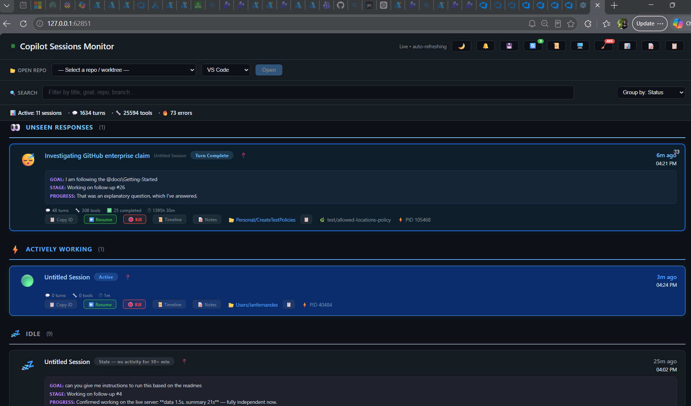

# Copilot CLI Session Dashboard

A [GitHub Copilot CLI extension](https://docs.github.com/en/copilot/concepts/agents/about-copilot-cli) that runs a local web dashboard for monitoring and managing all your concurrent Copilot CLI sessions.

> ⚠️ **Note:** This is a personal project I built before the official GitHub Copilot desktop app shipped its own session management UI. It is **not** intended to replicate or compete with the Copilot app — it just solves some different problems I had around multi-session workflows, workspace persistence, and AI-organized todos. Sharing in case any of it is useful to others.

> 🪟 **Platform:** Windows-first (uses Windows Terminal `wt` for tab launching and PowerShell for some helpers). The web dashboard itself works cross-platform, but tab-launching features require Windows Terminal. PRs to broaden platform support are welcome.



## Features

### 🖥️ Live Multi-Session Monitor (main page)

- Real-time view of **every running and recent CLI session** — status, turn count, tool calls, errors, last activity, summary, branch, repository.
- **Auto-refreshing** via Server-Sent Events (SSE) — no manual reload needed.
- **Search & filter** — type to instantly filter sessions by title, goal, repo, branch, or any text.
- **Group by** — organize session cards by status, repository, or branch.
- **Pin sessions** — pin important sessions to the top.
- **Per-session notes** — free-form notes attached to a session id, persisted to disk across restarts.
- **Timeline view** — expand any session card to see its full event history (turns, tool calls, errors).
- **Attention alerts** — sessions waiting for user input flash and trigger an optional sound alert (🔔 toggle).
- **Quick respond** — tooltip showing the question a waiting session is asking, so you can context-switch quickly.
- **Light/dark theme** — toggle with 🌙 button; remembered in localStorage.

### ▶️ Session Management

- **Resume** — one click opens a new Windows Terminal tab and resumes a session by id (`--resume`).
- **Focus** — click to bring an already-running session's terminal tab to the foreground (uses a warm PowerShell process for fast tab switching).
- **Kill** — terminate a running session from the dashboard.
- **Export active session IDs** — ⬇️ saves one active session ID per line to `~/Downloads/active-copilot-session-ids.txt`.
- **Cleanup stale sessions** — 🧹 button finds sessions older than 30 days and lets you delete their state directories.

### 💾 Workspace Save / Restore

- **Saved open-tab workspace** — the saved count and bulk restore refer to an open-tab snapshot, not every session ever observed. Confirmed process discovery updates the live snapshot and removes closed tabs; unavailable or stale discovery leaves it unchanged. Only sessions with conversation history and a valid working directory qualify.
- **Separate recovery archive** — SDK registrations and positive process observations are retained in a local SQLite database. Closing a tab does not delete its archive entry; use **Forget selected** on `/recovery` when finished. Temporary observations without session history are not imported.
- **Coordinated persistence** — all extension instances register heartbeats, but a database lease gives one coordinator responsibility for process discovery, JSON projections, and restores. Transactions serialize roster changes; the journal records opens, membership changes, and restore outcomes.
- **Previous-boot checkpoints** — detecting an OS boot change freezes the last confirmed open tabs for restore, independently of rolling backups. New tabs after startup do not overwrite that recovery target. Windows uses a stable boot counter when available, rather than a boot timestamp that can drift. The original migration baseline remains an immutable archive.
- **Rolling backups** — `saved-workspace.json` is a compatibility projection of the saved workspace, not the source of truth. Ten numbered backups rotate on membership changes, not ordering changes. Upgrading preserves the newest genuine open-tab snapshot; the old merged-archive projections are not treated as open tabs.
- **Manual save** (💾 button) — replace the restore target with the currently confirmed open tabs. Older and closed sessions remain available separately in Recovery.
- **Verified restore** (🔄 button) — launch at most two sessions concurrently, deduplicate across extension instances, and report queued/launching/failed/unconfirmed separately. A session is marked **resumed** only after both a fresh `session.resume` event and positive liveness evidence. The confirmation timeout is three minutes; retries are never automatic.
- **Recovery page** (`/recovery`) — choose sessions, copy resumable IDs, inspect failures, add previous-boot checkpoints, or search actual resume events for a local calendar date. Date searches stream conversation histories and handle daylight-saving transitions; last-message timestamps are not used as resume dates.
- **📜 Snapshot browser** — inspect rolling backups and add their sessions to recovery without replacing other entries or launching anything.

Liveness combines SDK heartbeats with PID creation times, CLI resume arguments, and validated legacy lock files. Stale or unavailable process discovery is shown as **unknown**, not silently treated as a closed session; new launches pause rather than risk duplicates. Missing conversation history or original working directories produce explicit errors instead of falling back to the home directory.

Restart existing CLI hosts after updating so they use the new coordinator and recovery UI. Older extension processes may still overwrite legacy JSON snapshots, but cannot shrink the canonical SQLite roster. Restore is always user-initiated; loading the extension does not reopen tabs automatically.

### 📝 AI-Organized Todos (with worktree launcher)

Accessible at `/todos`. Paste a brain-dump of tasks and let an LLM (via the Copilot chat API) parse and categorize them:

- **AI parsing** — sends your raw text to `gpt-4.1` (with fallback chain) to produce structured, categorized todos.
- **Drag & drop reordering** — within and across categories.
- **Mark complete / delete / edit** inline.
- **🚀 Worktree launcher** — click 🚀 on any todo to:
  1. Create a sibling `git worktree` for the selected repo on a `<alias>/<slug>` branch.
  2. Drop a `.copilot-todo.md` context file into it with the todo's description.
  3. Open a new terminal tab running `copilot` in that worktree.
- **Repo picker** — auto-discovers git repos from configurable scan directories.

### 📊 Session Analytics

Accessible at `/analytics`. Shows aggregate stats across all sessions:

- Total sessions, total turns, total tool calls, total completions, total errors.
- Per-session breakdown table.

### 📋 Activity Reports

Accessible at `/reports`. Generates weekly and monthly rollup reports:

- Sessions started, turns, tool calls, completions, errors per time period.
- Persisted as JSON in `~/.copilot/activity/reports/` for historical reference.

### 📂 Repo Opener

A dropdown in the header bar lets you quickly open any discovered repo in VS Code or Visual Studio.

### 🖥️ Screen Blank + Intrusion Detection (security/privacy)

- **Screen blank** — blacks out all monitors (click/key/mouse to dismiss). Useful when you step away.
- **Lock countdown** — after the blank is dismissed (someone touched your machine), a 3-second countdown starts before `LockWorkStation` fires. Cancel button in the dashboard UI.
- **Webcam capture** — on dismiss, captures a photo via webcam (requires Python + OpenCV) and saves to `~/.copilot/intrusion-photos/`.
- **Intrusion alert banner** — the dashboard shows a red flashing alert with the captured photo if someone triggered the blank while you were away.

## Installation

The extension uses `extension.mjs` and `session-recovery.mjs`, with no build step or `npm install`. Keep both files together (cloning the repository does this).

### Prerequisites

- **GitHub Copilot CLI** installed and signed in (this is what loads the extension)
- **Node.js 24+ runtime** with built-in `node:sqlite` support (provided by current Copilot CLI extension hosts; also required for local development)
- **Git** on `PATH` (used for repo discovery and worktree creation)
- **[GitHub CLI (`gh`)](https://cli.github.com/)** signed in (`gh auth login`) — used by the todos page to call the Copilot LLM for parsing your brain-dump
- **Windows Terminal (`wt`)** on `PATH` — required for any feature that opens a new terminal tab (Resume, Restore Workspace, Todos 🚀 launcher). Comes built-in on Windows 11; install from the Microsoft Store on Windows 10.

### Clone into the extensions directory

The extension must live in `<USER_PROFILE>/.copilot/extensions/session-dashboard`.

**Windows (PowerShell):**

```powershell
git clone https://github.com/fernandesi2244/copilot-cli-session-dashboard.git `
  "$env:USERPROFILE\.copilot\extensions\session-dashboard"
```

**macOS / Linux (bash):**

```bash
git clone https://github.com/fernandesi2244/copilot-cli-session-dashboard.git \
  ~/.copilot/extensions/session-dashboard
```

### Start it

The Copilot CLI auto-discovers extensions in `~/.copilot/extensions/` on next startup — no registration needed. Just launch Copilot CLI as usual:

```
copilot
```

On startup the extension picks a random free port and writes it to `~/.copilot/session-dashboard-port`. Open it in a browser:

```powershell
# Windows
Start-Process ("http://127.0.0.1:" + (Get-Content $HOME\.copilot\session-dashboard-port))
```

```bash
# macOS / Linux
open "http://127.0.0.1:$(cat ~/.copilot/session-dashboard-port)"   # macOS
xdg-open "http://127.0.0.1:$(cat ~/.copilot/session-dashboard-port)" # Linux
```

### Updating

The repo is just a git clone, so updating is a `git pull`:

```powershell
cd "$env:USERPROFILE\.copilot\extensions\session-dashboard"
git pull
```

You must then restart any running Copilot CLI host — the extension does not hot-reload.

## Configuration

Everything works out of the box, but you can tune two things:

### User alias (branch prefix)

Every branch the todos launcher creates is prefixed with your alias. Resolution order:

1. `COPILOT_DASHBOARD_USER_ALIAS` env var
2. `userAlias` in `~/.copilot/session-dashboard-config.json`
3. Local part of `git config --global user.email`
4. Literal `"user"`

### Copilot CLI command (for non-standard installs)

The dashboard launches new terminal tabs with `copilot --resume=<id>`. If your Copilot CLI is invoked via a wrapper, override the command:

1. `COPILOT_DASHBOARD_CLI_COMMAND` env var, **or**
2. `copilotCommand` in `~/.copilot/session-dashboard-config.json`

### Repo scan directories

The dashboard auto-discovers git repos in these directories so you can pick one in the todos UI. Defaults (each only used if it exists):

- `~/source/repos`
- `~/source`
- `~/Documents`
- `~/code`
- `~/projects`
- `~/git`

Extend via either:

- `COPILOT_DASHBOARD_REPO_DIRS` env var (`;` or `,` separated)
- `repoScanDirs: ["C:\\\\path\\\\one", "/home/me/other"]` in `~/.copilot/session-dashboard-config.json`

### Config file example

`~/.copilot/session-dashboard-config.json`:

```json
{
  "userAlias": "jane",
  "copilotCommand": "copilot",
  "repoScanDirs": ["D:\\\\repos", "C:\\\\work"]
}
```

## Files written

| Path | Purpose |
|---|---|
| `~/.copilot/session-dashboard-port` | Current HTTP port (overwritten on each start) |
| `~/.copilot/session-dashboard-notes.json` | Per-session notes |
| `~/.copilot/session-dashboard-todos.json` | Todos data |
| `~/.copilot/session-dashboard-config.json` | Optional user config |
| `~/.copilot/session-recovery.db` (plus SQLite WAL/SHM files) | Canonical recovery roster, observers, restore attempts, journal, and boot checkpoints |
| `~/.copilot/saved-workspace.json` and `.1` … `.10` | Compatibility projection and rolling snapshots |
| `~/.copilot/workspace-checkpoints/` | Immutable JSON exports of boot checkpoints and migration baseline |
| `~/.copilot/activity/reports/` | Weekly/monthly report JSON |
| `~/Downloads/active-copilot-session-ids.txt` | Active session IDs exported from the main dashboard |

## Platform notes

- **Windows:** Fully supported. Uses Windows Terminal (`wt`) for tab launching and PowerShell for screen-lock / focus helpers.
- **macOS / Linux:** The HTTP dashboard and most monitoring features will work, but anything that shells out to `wt` or PowerShell will be a no-op or fail. Pull requests adding cross-platform terminal-launch backends are welcome.
- **Intrusion detection:** Requires Python 3 (`py` on PATH) and OpenCV (`pip install opencv-python`) for webcam capture. If unavailable, everything else still works — you just won't get the photo.

## Development

The dashboard does **not** hot-reload. After editing `extension.mjs` you must restart your Copilot CLI host process. The chosen port also changes on every restart, so re-read `~/.copilot/session-dashboard-port` after restarting.

Run `npm test` for isolated recovery and HTTP integration tests (the SDK, user home, shell, and terminal are stubbed; no real sessions are launched). Run `node --check extension.mjs` for the extension syntax check.

See [`AGENTS.md`](./AGENTS.md) for instructions to AI assistants contributing to this code.

## License

MIT — see [LICENSE](./LICENSE).
